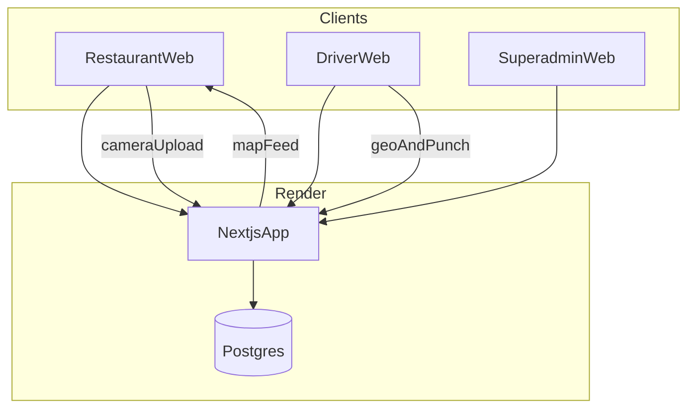

# DropBuddy multi-tenant web app

## Status

This document supersedes the Tauri / Epson ES-50 / local-inbox MVP (PR #2 / `feature/mvp2-groundwork`). That path is **abandoned** for the product direction below.

## Product summary

DropBuddy is a **Render-hosted Next.js** web app for restaurant delivery ops:

- Each **restaurant is a tenant**.
- **Superadmins** (us), **restaurant** users, and **drivers** have logins.
- Order slips are captured via **device camera / file upload** (no USB scanner).
- The app **auto-suggests** a driver; the restaurant **can override**.
- Drivers belong to **one restaurant at a time**.
- Drivers punch **Picked up** and **Delivered**; the restaurant sees **live driver location** on a map.

## Decisions locked

| Topic | Choice |
|-------|--------|
| Slip intake | Browser camera / gallery upload |
| Scanner / Tauri inbox | Out of scope |
| Assignment | Auto-suggest + restaurant override |
| Driver tenancy | One restaurant at a time |
| Hosting | Next.js web service + Postgres on Render (workforce / timetabling pattern) |

## Defaults (v1)

- Live location: browser **Geolocation** while driver is on an active delivery; restaurant map **short-polls**.
- Punch events store timestamp + optional lat/lng.
- OCR/structure: upload → server pipeline (stub first; real OCR/LLM later).

## Architecture

### Stack

- Next.js App Router + Route Handlers
- Prisma + PostgreSQL
- NextAuth (JWT) with `tenantId` + role flags
- Leaflet for restaurant map
- `render.yaml`: Node web service + managed DB; `prisma migrate deploy` on pre-deploy

### Tenancy (shared DB, row-level)

- `Tenant` = restaurant
- `User.tenantId` nullable for superadmins
- Domain rows always scoped by `tenantId`

### Role matrix

| Capability | Superadmin | Restaurant admin | Driver |
|------------|------------|------------------|--------|
| Manage tenants | yes | no | no |
| Capture / confirm orders | no | yes | no |
| Override driver assignment | no | yes | no |
| View live map | no | yes | own position only |
| Punch pickup / delivery | no | no | yes |
| Send location pings | no | no | yes |

### Core flows

1. **Intake:** Capture → `ScanAsset` → OCR/structure → draft `Order` → restaurant confirms.
2. **Suggest:** heuristic proposes driver → restaurant accepts or overrides → `DeliveryAssignment`.
3. **Punch + track:** Picked up → location pings → map → Delivered.
4. **Superadmin:** create tenants, invite restaurant admins, reassign drivers between restaurants.

## Data model (v0)

- `Tenant`, `User`, `Account`, `Session`, `VerificationToken` (NextAuth-compatible as needed)
- `DriverProfile` (user + tenant, active flag)
- `Order`, `OrderItem`
- `ScanAsset` (uploaded slip image metadata)
- `DeliveryAssignment`
- `PunchEvent` (`PICKED_UP` | `DELIVERED`)
- `LocationPing`

## Routes (v1)

- `/auth/signin`
- `/superadmin/tenants`
- `/restaurant/orders`
- `/restaurant/map`
- `/driver`

## Out of scope for foundation PR

- Production OCR/LLM providers
- WebSockets (poll first)
- Native driver apps
- Old Vite sim batching / kitchen-start optimization
